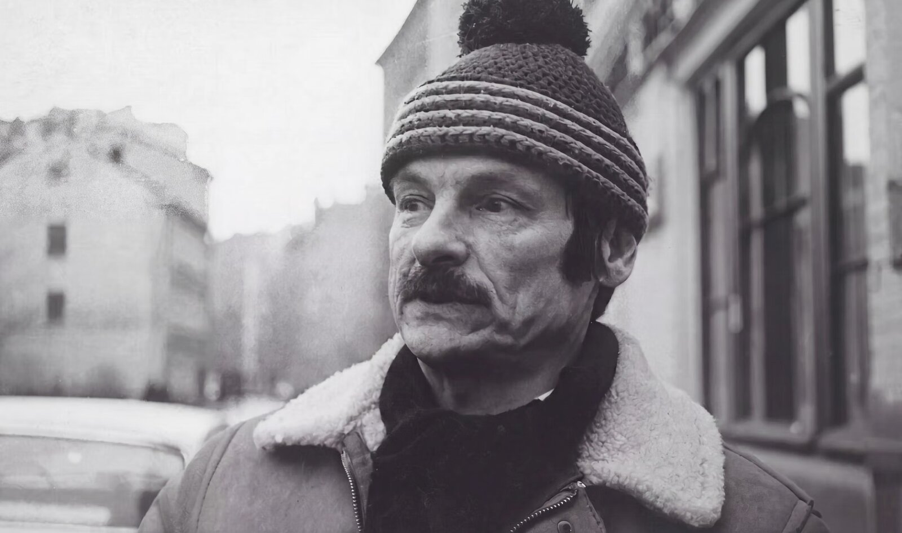
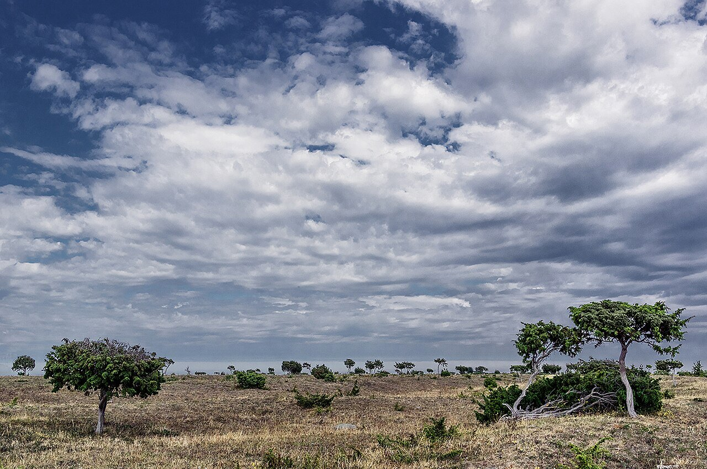
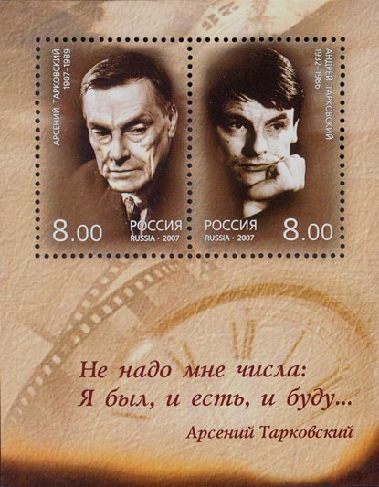
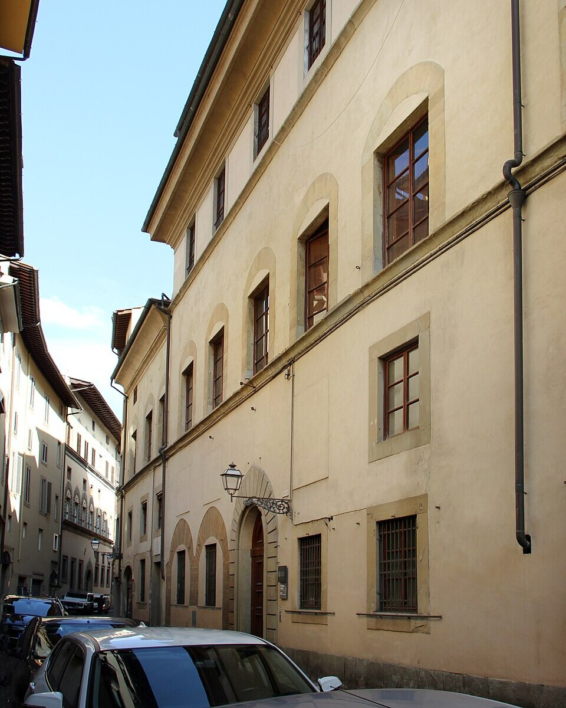
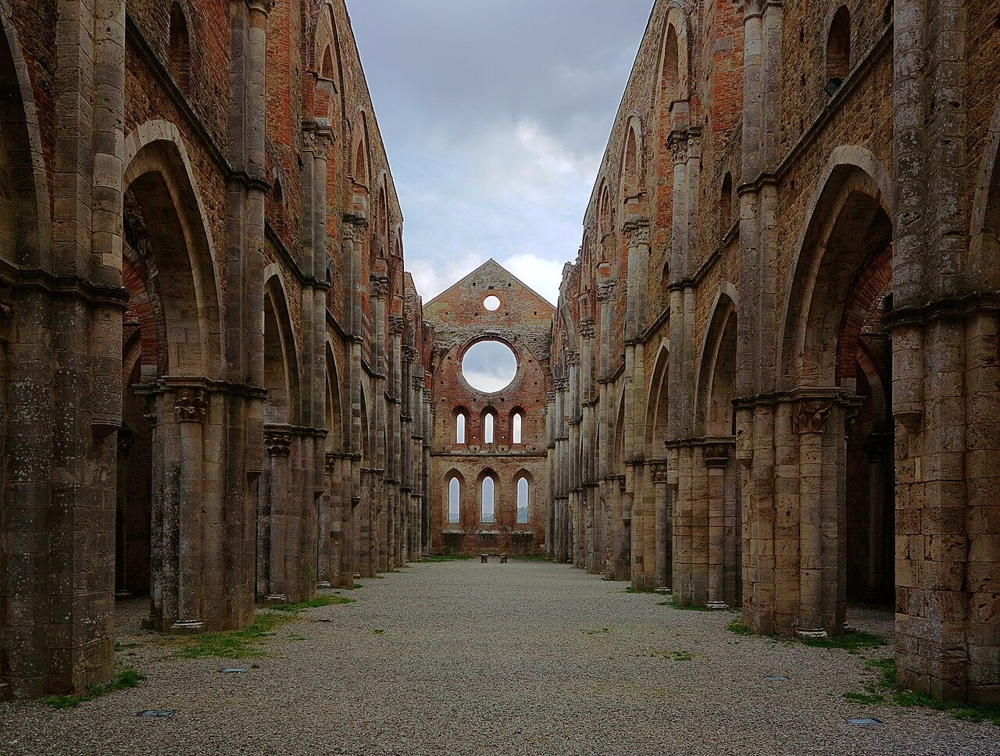

I started with a question about [Andrei Tarkovsky](https://en.wikipedia.org/wiki/Andrei_Tarkovsky)'s [_The Sacrifice_](<https://en.wikipedia.org/wiki/The_Sacrifice_(1986_film)>). Then I wondered what became of the son to whom the film was dedicated. That question led backwards—to Tarkovsky's father, the poet [Arseny](https://en.wikipedia.org/wiki/Arseny_Tarkovsky); to revolution and civil war; to his mother's memories; and forwards again, to the directors around the world who have inherited, contested, and transformed his cinema.

The connecting idea is **inheritance**. What can one generation leave another when homes burn, nations change, families separate, and even memory is unreliable?

<figure>

<figcaption>Andrei Tarkovsky in Moscow, autumn 1980. The photographer's note on the envelope says he was scouting locations for <em>Nostalghia</em>; the street is near the Donskoy Monastery or on 1st Shchipkovsky Lane, where Tarkovsky grew up. Photo: Boris Baldin, CC BY-SA 4.0.</figcaption>
</figure>

This is a journey through films and history, not a claim to have decoded the director's symbols. Where an artistic influence is documented, I say so; where I am making a comparison, I treat it as a comparison.

## Table of contents

## The tree: _The Sacrifice_ (1986)

A father and his young son plant a dead tree. The father tells a story about an old monk, Pamve, who planted a barren tree on a hillside and told his young disciple to water it every day until it came back to life. The disciple obeyed without knowing whether it would ever matter, and after three years the tree revived. This seemingly futile action will return at the end of Tarkovsky's final film.

The father, Alexander, is a former actor and intellectual living with his family on a Swedish island. During his birthday celebration, news arrives of what seems to be a nuclear catastrophe. In fear, Alexander makes a promise to God: if the disaster is averted, he will give up everything—home, family, possessions, speech. The enigmatic postman Otto suggests that Alexander visit Maria, a woman said to have extraordinary powers. The next morning the world appears normal again. Alexander burns his house to fulfill his vow.

<figure>

<figcaption>Närsholmen, a peninsula on Gotland, where the exteriors of <em>The Sacrifice</em> were filmed. Photo: Måns Hagberg, CC BY-SA 4.0.</figcaption>
</figure>

It is tempting to demand an answer: did prayer work? Did Maria save the world? Was the catastrophe a vision, or was Alexander experiencing a psychological crisis? Tarkovsky refuses a definitive explanation. The uncertainty is the film's moral terrain.

**Can a sacrifice be noble when it destroys what other people also love?** Alexander's act may be faith, madness, or both. His family bears its consequences. This is more disturbing than a simple parable about belief.

At the end the child tends the tree and asks about the [opening of John's Gospel](https://en.wikipedia.org/wiki/John_1:1): "In the beginning was the Word." The father has fallen silent; the child speaks. And the film is dedicated to Tarkovsky's son Andrei, with hope and confidence.

## The son: a reunion in the shadow of death

Andrei Andreevich Tarkovsky was born in 1970. During his father's work abroad in the early 1980s, he remained in the USSR. The Soviet authorities refused permission for him to join his parents (Tarkovsky and his second wife, Larisa) in the West, and a dispute over artistic freedom became a separation between father and son.

On **19 January 1986**, fifteen-year-old Andrei and his grandmother, eighty-five-year-old Anna Semyonovna Egorkina, finally arrived in Paris. The French president [François Mitterrand](https://en.wikipedia.org/wiki/Fran%C3%A7ois_Mitterrand) had written to Soviet leader [Mikhail Gorbachev](https://en.wikipedia.org/wiki/Mikhail_Gorbachev) on Tarkovsky's behalf. Contemporary news reports describe the sudden granting of exit visas after a four-year struggle with the Soviet authorities [1]. [Chris Marker](https://en.wikipedia.org/wiki/Chris_Marker) filmed the reunion; that footage opens his [_One Day in the Life of Andrei Arsenevich_](https://en.wikipedia.org/wiki/One_Day_in_the_Life_of_Andrei_Arsenevich).

Tarkovsky was already seriously ill. He died in Paris on **29 December 1986**, aged fifty-four. Father and son had less than a year together after their long separation.

The younger Andrei went on to work in documentary filmmaking and the preservation of his father's legacy. His [_Andrey Tarkovsky: A Cinema Prayer_](https://www.labiennale.org/en/cinema/2019/venice-classics/andrey-tarkovsky-cinema-prayer) (2019) offers a valuable counterpoint to any retelling of these events: archival material and the father's own words, not just our interpretations.

I cannot help seeing the image of the boy watering the tree as a figure for continuity after a father's death. But this is an interpretation of the film—not a claim to know the son's private motivations.

## The father: Arseny Tarkovsky and the revolution

The filmmaker's father, **Arseny Alexandrovich Tarkovsky (1907–1989)**, was a poet and translator whose verse later entered [_Mirror_](<https://en.wikipedia.org/wiki/Mirror_(1975_film)>), [_Stalker_](<https://en.wikipedia.org/wiki/Stalker_(1979_film)>), and [_Nostalghia_](https://en.wikipedia.org/wiki/Nostalghia). His mother, **Maria Ivanovna Vishnyakova (1907–1979)**, worked for many years as a proofreader at a Moscow printing house (the printing-house episode in _Mirror_ draws on this) and largely raised Andrei and his sister [Marina](https://en.wikipedia.org/wiki/Marina_Tarkovskaya), born in 1934, after Arseny left the family in the summer of 1937 [9].

Arseny's life reaches into the world before the director was born. He grew up in [Elisavetgrad](https://en.wikipedia.org/wiki/Kropyvnytskyi) (today Kropyvnytskyi, Ukraine) during the last years of the Russian Empire. His father, Alexander Karlovich Tarkovsky (1862–1924), belonged to a populist revolutionary circle in the 1880s and spent three years in tsarist prisons and five in exile in Eastern Siberia. Arseny later said his father had been arrested over an attempt on the governor of Kharkov; the documents do not bear that out [10].

That history complicates any simplistic portrait of a family eternally opposed to government. The grandfather was himself a revolutionary under the old regime. But revolution did not spare the family from grief.

Arseny's older brother Valery became involved in revolutionary politics and died in May 1919 amid fighting against forces associated with [Nykyfor Hryhoriv](https://en.wikipedia.org/wiki/Nykyfor_Hryhoriv) in Ukraine [2]. Arseny was eleven.

<figure>

<figcaption>Arseny Tarkovsky (right), aged about four, with his mother and his older brother. Elisavetgrad, 1911. Photo: Israel Bril, public domain.</figcaption>
</figure>

A later biographical account describes an extraordinary episode in **1921**: Arseny and friends published an anti-Lenin acrostic, were arrested, and he escaped while being transported for trial [2]. The incident is widely retold, but not every dramatic detail can be checked against accessible contemporary documents; it should be read with that qualification.

Arseny became a poet and translator in Soviet Russia, served as a war correspondent during World War II, was severely wounded in December 1943, and lost a leg [2]. Remarkably, his first collection of original poems was published only in 1962, the year his son released his first feature film, [_Ivan's Childhood_](https://en.wikipedia.org/wiki/Ivan%27s_Childhood). Nick James, writing in the BFI's _Sight and Sound_, treats the father's poetry as a central influence on the son's cinema [3]. Andrei used seven of Arseny's poems in three films, and Alex Nemser and Nariman Skakov have translated all seven into English [8]:

- In _Mirror_, Arseny reads four himself: «[Первые свидания](https://www.culture.ru/poems/11000/pervye-svidaniya)» ("First Meetings"), «[С утра я тебя дожидался вчера…](https://www.culture.ru/poems/10978/s-utra-ya-tebya-dozhidalsya-vchera)» ("From the Morning…"), «[Жизнь, жизнь](https://www.culture.ru/poems/11091/zhizn-zhizn)» ("Life, Life") and «[Эвридика](https://www.culture.ru/poems/10963/evridika)» ("Eurydice").
- In _Stalker_, the Stalker recites «[Вот и лето прошло…](https://www.culture.ru/poems/11096/vot-i-leto-proshlo)» ("So Summer Has Passed") in the Zone and attributes it to Porcupine's brother.
- In _Nostalghia_, Gorchakov recites «[Я в детстве заболел…](https://ruthenia.ru/60s/tarkovskij/ja_v_detxtve.htm)» ("As a Child…") from memory, not quite accurately, and «[Меркнет зрение — сила моя…](https://www.culture.ru/poems/11015/merknet-zrenie-sila-moya)» ("My sight, my strength, dims…") is heard in Italian.

<figure>

<figcaption>Father and son on one sheet: Russian stamps issued in 2007, a hundred years after Arseny's birth and seventy-five after Andrei's. The margin quotes Arseny: «Не надо мне числа: / Я был, и есть, и буду…», "I have no need of dates: I was, and am, and will be" (my translation). Public domain.</figcaption>
</figure>

For the maternal family's precise experience in 1917–1921, the widely available biographical record is much thinner. I would rather leave that uncertainty visible than construct an unsupported narrative of confiscations or persecution.

## _Mirror_: the family becomes cinematic time

_Mirror_ (1975) is not a conventional autobiography in chronological sequence. It moves like recollection: a mother seated on a fence, wind across a field, a house, wartime sounds, dreams, newsreels, an adult's guilt. The same actress plays figures across generations. And Arseny reads his poems over the images.

Here the father's voice literally inhabits the son's vision. Yet the film is not a private family album. It allows the upheavals of the twentieth century to surface in the intimate textures of childhood.

How do we remember history? Not only through dates, battles, decrees, and names. Sometimes through the tone of a parent's voice, the light in a room, or the fear that someone will not return. _Mirror_ reproduces that experience without reducing it to an explanation.

The important technical innovation is duration. Tarkovsky often allows a shot to continue after a plot-driven film would cut. Wind, water, silence and faces have time to become events in their own right. Nature is not merely a code where rain means grief and fire means purification. It remains concrete while gathering emotional force.

This is why knowing the family history enriches _Mirror_—but does not exhaust it.

## _Nostalghia_: leaving without planning to be an exile

Tarkovsky did not originally depart the Soviet Union as a permanent émigré. In 1982 he went to Italy with official permission to make _Nostalghia_ (1983), working with Italian collaborators including [Tonino Guerra](https://en.wikipedia.org/wiki/Tonino_Guerra).

He had experienced years of conflict with the Soviet film establishment. [_Andrei Rublev_](<https://en.wikipedia.org/wiki/Andrei_Rublev_(film)>) had encountered prolonged release problems; other films and projects faced resistance. International recognition did not eliminate domestic restrictions.

On **10 July 1984**, at a press conference in Milan, he announced his decision not to return to the USSR. Contemporary reporting quotes his complaint that his filmmaking had been repeatedly obstructed and records the unresolved separation from his son [4].

Calling this simply a political defection misses its personal and artistic dimensions. He wanted to make films and to be with his family. Instead, obtaining freedom to work abroad meant losing an ordinary home life in Russia.

<figure>

<figcaption>Palazzo Gianni Vegni, Via di San Niccolò, Florence. A plaque on the building, put up by the city and the Tarkovsky Foundation on 29 December 2006, calls him an "exile in Florence" who "spent the last years of his life in this house, guest and honorary citizen of the city of Florence." Photo: Francesco Bini, CC BY-SA 4.0.</figcaption>
</figure>

_Nostalghia_, completed before the public break, now feels uncannily autobiographical: a Russian intellectual travels in Italy, neither at home abroad nor able to inhabit the homeland he imagines. In the final image, a Russian house seems contained within an Italian abbey. The two landscapes coexist without becoming one.

<figure>

<figcaption>The roofless nave of the Abbey of San Galgano in Tuscany, where Tarkovsky filmed the final shot of <em>Nostalghia</em>. Photo: Spike, CC BY-SA 4.0.</figcaption>
</figure>

By _The Sacrifice_, made in Sweden with cinematographer [Sven Nykvist](https://en.wikipedia.org/wiki/Sven_Nykvist), the lost house is no longer only remembered. It is burned.

## Why is Tarkovsky so highly regarded?

It is not because his films are difficult, or because their characters speak philosophically, or because mist and water look beautiful. His achievement is more specific: he expanded cinema's ability to render **experienced time**.

His book [_Sculpting in Time_](https://search.worldcat.org/title/sculpting-in-time-reflections-on-the-cinema/oclc/31736519) explains why the medium's distinctive material is not simply the moving image, but time impressed into it.

Consider three films:

In **[_Solaris_](<https://en.wikipedia.org/wiki/Solaris_(1972_film)>) (1972)**, an encounter with an alien intelligence becomes an inquiry into grief, guilt, love, and the limits of knowing another person. The central puzzle cannot be solved with better equipment.

In **_Stalker_ (1979)**, a room supposedly fulfills one's deepest desire. But what if we do not know our own deepest desire? The science-fiction premise becomes a test of self-knowledge.

In **_Mirror_**, memory itself becomes the structure, rather than information inserted into a conventional story.

The painterly references—to [Leonardo](https://en.wikipedia.org/wiki/Leonardo_da_Vinci), [Bruegel](https://en.wikipedia.org/wiki/Pieter_Bruegel_the_Elder) and other European masters—the father's poems, Orthodox spiritual imagery and unusual soundscapes all contribute. But imitating the wet floors and long tracking shots misses the point. **A Tarkovskian shot must do something with our sense of time.**

There are legitimate objections: his films can feel excessively slow, his characters can declaim rather than converse, and women are at times treated mainly through men's spiritual quests. Appreciation need not be worship. His achievements are worth serious criticism, not protective reverence.

## The international afterlife: influence and disagreement

Nick James's substantial BFI essay, ["The Tarkovsky legacy"](https://www.bfi.org.uk/sight-and-sound/features/tarkovsky-legacy), is an excellent map of both explicit influence and more subtle aesthetic kinships [3].

**[Ingmar Bergman](https://en.wikipedia.org/wiki/Ingmar_Bergman)** is a crucial predecessor and, at a distance, an interlocutor—though the two men never spoke. Tarkovsky first saw him in September 1984, from the audience at a Film Institute screening in Stockholm, and did not go up to him. A year later, at a film-poster exhibition in Stockholm's Film House, Michal Leszczylowski, Tarkovsky's editor on _The Sacrifice_, watched the two notice each other fifteen meters apart, turn at the same moment and walk off in opposite directions. Meetings were arranged and called off again and again; Anna-Lena Wibom, who produced _The Sacrifice_, recalled that the thought of needing an interpreter irritated Bergman, though the film scholar Dmitry Salynsky doubts that was the real obstacle [7]. [_Winter Light_](https://en.wikipedia.org/wiki/Winter_Light) (1963) addresses faith and God's silence; _The Sacrifice_ was made with important Swedish collaborators, including Bergman's cinematographer Sven Nykvist. **[Robert Bresson's](https://en.wikipedia.org/wiki/Robert_Bresson)** [_Diary of a Country Priest_](https://en.wikipedia.org/wiki/Diary_of_a_Country_Priest) (1951) and **[Michelangelo Antonioni's](https://en.wikipedia.org/wiki/Michelangelo_Antonioni)** [_L'Avventura_](https://en.wikipedia.org/wiki/L%27Avventura) (1960) provide other routes into spiritual austerity and landscapes of absence.

**[Lars von Trier](https://en.wikipedia.org/wiki/Lars_von_Trier)** offers a documented line of influence. He has spoken repeatedly of his admiration for _Mirror_ and dedicated [_Antichrist_](<https://en.wikipedia.org/wiki/Antichrist_(film)>) (2009) to Tarkovsky. His [_Melancholia_](<https://en.wikipedia.org/wiki/Melancholia_(2011_film)>) (2011) makes a provocative companion to _The Sacrifice_: the world may end, but the possibility of redemption is entirely different.

**[Béla Tarr](https://en.wikipedia.org/wiki/B%C3%A9la_Tarr)** (1955–2026), especially with [_Werckmeister Harmonies_](https://en.wikipedia.org/wiki/Werckmeister_Harmonies) (2000), teaches us to distrust superficial resemblance. His long takes and apocalyptic atmospheres invite comparisons with Tarkovsky, but Tarr drew the line himself: Tarkovsky was religious and he was not; Tarkovsky "always had hope; he believed in God" [3]. In a 2011 interview he put it more plainly still: he does not believe in God [5]. Similar form, different metaphysics.

**[Nuri Bilge Ceylan](https://en.wikipedia.org/wiki/Nuri_Bilge_Ceylan)** names Tarkovsky among his biggest influences [6]. In [_Distant_](<https://en.wikipedia.org/wiki/Distant_(film)>) (_Uzak_, 2002), the sight of someone watching _Stalker_ even becomes a joke about aesthetic pretension. [_Once Upon a Time in Anatolia_](https://en.wikipedia.org/wiki/Once_Upon_a_Time_in_Anatolia) (2011) transforms patient observation into a moral mystery of ordinary people.

**[Andrey Zvyagintsev's](https://en.wikipedia.org/wiki/Andrey_Zvyagintsev)** [_The Return_](<https://en.wikipedia.org/wiki/The_Return_(2003_film)>) (2003) and [_The Banishment_](https://en.wikipedia.org/wiki/The_Banishment) (2007) converse with Tarkovsky in their father figures, water, landscape and moral uncertainty. They should not be mistaken for mere copies.

Other films make illuminating **comparisons rather than demonstrable direct lines of influence**. **[Terrence Malick's](https://en.wikipedia.org/wiki/Terrence_Malick)** [_The Tree of Life_](<https://en.wikipedia.org/wiki/The_Tree_of_Life_(film)>) (2011) expands a remembered childhood into cosmic history; critics, James among them [3], count Malick among Tarkovsky's heirs, but Malick, who almost never gives interviews, has not said so himself. **[Krzysztof Kieślowski's](https://en.wikipedia.org/wiki/Krzysztof_Kie%C5%9Blowski)** [_Three Colours: Red_](https://en.wikipedia.org/wiki/Three_Colours:_Red) (1994) asks about invisible moral connections. **[Apichatpong Weerasethakul's](https://en.wikipedia.org/wiki/Apichatpong_Weerasethakul)** [_Uncle Boonmee Who Can Recall His Past Lives_](https://en.wikipedia.org/wiki/Uncle_Boonmee_Who_Can_Recall_His_Past_Lives) (2010) and [_Memoria_](<https://en.wikipedia.org/wiki/Memoria_(2021_film)>) (2021) explore forms of memory not confined to one individual.

These differences are the measure of Tarkovsky's reach. Influence matters most when it generates new questions, not perfect reproductions of an established style.

## An eight-film viewing route

I would follow this sequence to study the lineage rather than merely assemble a list of slow films (titles link to IMDb):

1. **Chris Marker, [_One Day in the Life of Andrei Arsenevich_](https://www.imdb.com/title/tt14586242/) (2000).** The filmmaker, his work, and his last years, beginning with the reunion with his son.
2. **Ingmar Bergman, [_Winter Light_](https://www.imdb.com/title/tt0057358/) (1963).** The silence of God before _The Sacrifice_.
3. **Andrei Tarkovsky, [_Mirror_](https://www.imdb.com/title/tt0072443/) (1975).** How an individual remembers a century.
4. **Terrence Malick, [_The Tree of Life_](https://www.imdb.com/title/tt0478304/) (2011).** The family and the universe in one visual thought.
5. **Lars von Trier, [_Melancholia_](https://www.imdb.com/title/tt1527186/) (2011).** An apocalypse without Alexander's bargain.
6. **Béla Tarr and [Ágnes Hranitzky](https://en.wikipedia.org/wiki/%C3%81gnes_Hranitzky), [_Werckmeister Harmonies_](https://www.imdb.com/title/tt0249241/) (2000).** Time without the same promise of transcendence.
7. **Nuri Bilge Ceylan, [_Once Upon a Time in Anatolia_](https://www.imdb.com/title/tt1827487/) (2011).** Mystery and responsibility without supernatural rules.
8. **Apichatpong Weerasethakul, [_Memoria_](https://www.imdb.com/title/tt8399288/) (2021).** Memory at the boundary of consciousness and the world.

Three worthwhile detours are Bresson's [_Diary of a Country Priest_](https://www.imdb.com/title/tt0042619/), Antonioni's [_L'Avventura_](https://www.imdb.com/title/tt0053619/), and Zvyagintsev's [_The Return_](https://www.imdb.com/title/tt0376968/). Then watch [_The Sacrifice_](https://www.imdb.com/title/tt0091670/) again.

## One last tree

Laid out on one timeline, the four generations show the pattern plainly: imperial repression, revolution and civil war, a poet's war wound, the divided household of _Mirror_, bureaucratic restrictions, exile, and a son reunited with his father only months before his death. The arrows between the lanes are the inheritance that can actually be documented: seven poems, one dedication, one film made from a father's own words.

<!-- figure:tarkovsky-lifelines -->
<figure class="lifelines not-prose" id="tarkovsky-lifelines" style="--ll-n:5">

Four generations, one timeline

<ul class="ll-legend" aria-label="Legend">
<li>documented in the numbered sources</li>
<li>a later retelling</li>
<li>a thin record</li>
<li>passed from one life to another</li>
<li>a family separated</li>
</ul>

<fieldset class="ll-pick">
<legend class="ll-sr">Highlight one life</legend>
<label class="ll-chip" style="grid-column:2"><input class="ll-sr" type="radio" name="tarkovsky-lifelines" value="1">Alexander K.</label>
<label class="ll-chip" style="grid-column:3"><input class="ll-sr" type="radio" name="tarkovsky-lifelines" value="2">Arseny</label>
<label class="ll-chip" style="grid-column:4"><input class="ll-sr" type="radio" name="tarkovsky-lifelines" value="3">Maria</label>
<label class="ll-chip" style="grid-column:5"><input class="ll-sr" type="radio" name="tarkovsky-lifelines" value="4">Andrei</label>
<label class="ll-chip" style="grid-column:6"><input class="ll-sr" type="radio" name="tarkovsky-lifelines" value="5">Andrei Jr.</label>

<label class="ll-all"><input class="ll-sr" type="radio" name="tarkovsky-lifelines" value="0" checked>Everyone</label>

Pick a name to follow one life; the others fade.

<strong>Alexander Karlovich Tarkovsky</strong>, 1862–1924. A populist revolutionary of the 1880s: three years in tsarist prisons, five in Siberian exile.

<strong>Arseny Tarkovsky</strong>, 1907–1989. Poet and translator; seven of his poems are spoken in his son's films.

<strong>Maria Vishnyakova</strong>, 1907–1979. Proofreader at a Moscow printing house; raised Andrei and Marina after 1937.

<strong>Andrei Tarkovsky</strong>, 1932–1986. Filmmaker; stayed in the West from 1984 and died in Paris.

<strong>Andrei Andreevich Tarkovsky</strong>, born 1970. Documentary filmmaker and keeper of his father's legacy.

</fieldset>
<ol class="ll-grid" style="--ll-rows:29">
<li class="ll-layer" aria-hidden="true"></li>
<li class="ll-ev" style="grid-row:1" data-lanes="1"><time class="ll-when" datetime="1880">1880s</time>
<strong class="ll-h">Prison and exile</strong> Alexander Karlovich, a member of a populist circle, spends three years in tsarist prisons and five in exile in Eastern Siberia. <a href="#the-father-arseny-tarkovsky-and-the-revolution">The father</a> · <a href="#sources-and-further-reading" aria-label="source 10">[10]</a>
</li>
<li class="ll-gap" style="grid-row:2" aria-hidden="true">⋮two decades</li>
<li class="ll-ev" style="grid-row:3" data-lanes="2 3"><time class="ll-when" datetime="1907">1907</time>
<strong class="ll-h">Arseny and Maria are born</strong> Arseny in Elisavetgrad, in the south of the Russian Empire; Maria Vishnyakova, his future wife, the same year. <a href="#the-father-arseny-tarkovsky-and-the-revolution">The father</a>
</li>
<li class="ll-gap" style="grid-row:4" aria-hidden="true">⋮ten years</li>
<li class="ll-era" style="grid-row:5">Revolution and civil war, 1917–1921</li>
<li class="ll-ev" style="grid-row:6" data-lanes="2"><time class="ll-when" datetime="1919-05">May 1919</time>
<strong class="ll-h">Valery is killed</strong> Arseny's elder brother dies in battle against the forces of Nykyfor Hryhoriv. Arseny is eleven. <a href="#the-father-arseny-tarkovsky-and-the-revolution">The father</a> · <a href="#sources-and-further-reading" aria-label="source 2">[2]</a>
</li>
<li class="ll-ev" style="grid-row:7" data-lanes="2"><time class="ll-when" datetime="1921">1921</time>
<strong class="ll-h">Arrest and escape, as later told</strong> An anti-Lenin acrostic, an arrest, an escape on the way to trial. Widely retold; not every detail can be checked. <a href="#the-father-arseny-tarkovsky-and-the-revolution">The father</a> · <a href="#sources-and-further-reading" aria-label="source 2">[2]</a>
</li>
<li class="ll-ev" style="grid-row:8" data-lanes="1"><time class="ll-when" datetime="1924">1924</time>
<strong class="ll-h">Alexander Karlovich dies</strong>
</li>
<li class="ll-gap" style="grid-row:9" aria-hidden="true">⋮eight years</li>
<li class="ll-ev" style="grid-row:10" data-lanes="2 3 4"><time class="ll-when" datetime="1932">1932</time>
<strong class="ll-h">Andrei is born</strong> His sister, Marina, follows in 1934. <a href="#the-father-arseny-tarkovsky-and-the-revolution">The father</a>
</li>
<li class="ll-ev" style="grid-row:11" data-lanes="2 3"><time class="ll-when" datetime="1937">1937</time>
<strong class="ll-h">The household divides</strong> Arseny leaves the family. Maria, a proofreader at a Moscow printing house, raises the children; <em>Mirror</em> will return to both. <a href="#the-father-arseny-tarkovsky-and-the-revolution">The father</a> · <a href="#sources-and-further-reading" aria-label="source 9">[9]</a>
</li>
<li class="ll-era" style="grid-row:12">War, 1941–1945</li>
<li class="ll-ev" style="grid-row:13" data-lanes="2"><time class="ll-when" datetime="1943-12">Dec 1943</time>
<strong class="ll-h">A war correspondent is wounded</strong> Arseny is hit at the front; his leg is amputated. <a href="#the-father-arseny-tarkovsky-and-the-revolution">The father</a> · <a href="#sources-and-further-reading" aria-label="source 2">[2]</a>
</li>
<li class="ll-gap" style="grid-row:14" aria-hidden="true">⋮nineteen years</li>
<li class="ll-ev" style="grid-row:15" data-lanes="2 4"><time class="ll-when" datetime="1962">1962</time>
<strong class="ll-h">Two debuts in one year</strong> Arseny's first collection of his own poems; Andrei's first feature, <em>Ivan's Childhood</em>. <a href="#the-father-arseny-tarkovsky-and-the-revolution">The father</a>
</li>
<li class="ll-ev" style="grid-row:16" data-lanes="4 5"><time class="ll-when" datetime="1970">1970</time>
<strong class="ll-h">Andrei Andreevich is born</strong> The son of Andrei and his second wife, Larisa. <a href="#the-son-a-reunion-in-the-shadow-of-death">The son</a>
</li>
<li class="ll-ev" style="grid-row:17" data-lanes="2 4"><time class="ll-when" datetime="1975">1975</time>
<strong class="ll-h"><em>Mirror</em></strong> 4 poems Arseny reads four of his poems, in his own voice, over his son's remembered childhood. <a href="#mirror-the-family-becomes-cinematic-time">Mirror</a> · <a href="#sources-and-further-reading" aria-label="source 8">[8]</a>
</li>
<li class="ll-ev" style="grid-row:18" data-lanes="2 4"><time class="ll-when" datetime="1979">1979</time>
<strong class="ll-h"><em>Stalker</em></strong> 1 poem The Stalker recites “So Summer Has Passed” in the Zone. <a href="#the-father-arseny-tarkovsky-and-the-revolution">The father</a> · <a href="#sources-and-further-reading" aria-label="source 8">[8]</a>
</li>
<li class="ll-ev" style="grid-row:19" data-lanes="3" data-repeat><time class="ll-when" datetime="1979">1979</time>
<strong class="ll-h">Maria dies</strong>
</li>
<li class="ll-era" style="grid-row:20">Abroad, 1982–1986</li>
<li class="ll-ev" style="grid-row:21" data-lanes="4 5"><time class="ll-when" datetime="1982">1982</time>
<strong class="ll-h">To Italy, without his son</strong> Andrei leaves with official permission to make <em>Nostalghia</em>; the Soviet authorities keep the boy at home. <a href="#nostalghia-leaving-without-planning-to-be-an-exile">Nostalghia</a>
</li>
<li class="ll-ev" style="grid-row:22" data-lanes="2 4"><time class="ll-when" datetime="1983">1983</time>
<strong class="ll-h"><em>Nostalghia</em></strong> 2 poems Gorchakov recites one of Arseny's poems from memory; another is heard in Italian. <a href="#the-father-arseny-tarkovsky-and-the-revolution">The father</a> · <a href="#sources-and-further-reading" aria-label="source 8">[8]</a>
</li>
<li class="ll-ev" style="grid-row:23" data-lanes="4"><time class="ll-when" datetime="1984-07-10">10 Jul 1984</time>
<strong class="ll-h">Milan: he will not return</strong> A press conference announces his decision to stay in the West. <a href="#nostalghia-leaving-without-planning-to-be-an-exile">Nostalghia</a> · <a href="#sources-and-further-reading" aria-label="source 4">[4]</a>
</li>
<li class="ll-ev" style="grid-row:24" data-lanes="4 5"><time class="ll-when" datetime="1986-01-19">19 Jan 1986</time>
<strong class="ll-h">Reunion in Paris</strong> Andrei Jr., fifteen, arrives with his grandmother, Anna Egorkina, eighty-five. Chris Marker films it. <a href="#the-son-a-reunion-in-the-shadow-of-death">The son</a> · <a href="#sources-and-further-reading" aria-label="source 1">[1]</a>
</li>
<li class="ll-ev" style="grid-row:25" data-lanes="4 5"><time class="ll-when" datetime="1986">1986</time>
<strong class="ll-h"><em>The Sacrifice</em></strong> dedication The last film is dedicated to his son, with hope and confidence. <a href="#the-tree-the-sacrifice-1986">The tree</a>
</li>
<li class="ll-ev" style="grid-row:26" data-lanes="4"><time class="ll-when" datetime="1986-12-29">29 Dec 1986</time>
<strong class="ll-h">Andrei dies in Paris</strong> He is fifty-four. Father and son have had less than a year together. <a href="#the-son-a-reunion-in-the-shadow-of-death">The son</a>
</li>
<li class="ll-ev" style="grid-row:27" data-lanes="2"><time class="ll-when" datetime="1989-05">May 1989</time>
<strong class="ll-h">Arseny dies</strong> The poet outlives his son by almost two and a half years. <a href="#the-father-arseny-tarkovsky-and-the-revolution">The father</a> · <a href="#sources-and-further-reading" aria-label="source 2">[2]</a>
</li>
<li class="ll-gap" style="grid-row:28" aria-hidden="true">⋮thirty years</li>
<li class="ll-ev" style="grid-row:29" data-lanes="4 5"><time class="ll-when" datetime="2019">2019</time>
<strong class="ll-h"><em>A Cinema Prayer</em></strong> archive Andrei Jr. builds a film from archival material and his father's own words. <a href="#the-son-a-reunion-in-the-shadow-of-death">The son</a>
</li>
</ol>
<figcaption>The people this essay follows, one lane per life, with time running down the page and long silences marked. Each row links to the section that tells its story and to the numbered sources. Tarkovsky also had an elder son, Arseny (born 1962), from his first marriage, to <a href="https://en.wikipedia.org/wiki/Irma_Raush">Irma Raush</a>; this essay follows the younger son, Andrei.</figcaption>
</figure>
<!-- /figure:tarkovsky-lifelines -->

It would be too easy to turn this into a myth of a family fated to oppose the state. Their experiences and commitments were more complicated. Nor does biography alone explain why Tarkovsky matters artistically.

What stays with me is a different possibility: **continuity is an action, not a guarantee**.

One filmmaker believes in an act of faith. Another finds only rain and mud. Another hears an inexplicable sound that seems older than herself. Each is responding, in a different language, to questions of time, loss, memory and the limits of knowledge.

At the end of _The Sacrifice_, the child waters a tree that may never revive. He does not know the outcome. Neither do we.

And perhaps this is where an account of Tarkovsky's world influence should end: not with a canon or a ranking, but with somebody continuing the work.

Complement with [_Directed by Andrei Tarkovsky_](https://jonathanrosenbaum.net/?p=9615) (1988), Michal Leszczylowski's documentary about the making of _The Sacrifice_, which follows both attempts to film the burning house; [_Voyage in Time_](https://en.wikipedia.org/wiki/Voyage_in_Time) (1983), in which Tarkovsky and Tonino Guerra travel through Italy looking for the places of _Nostalghia_; [_Instant Light_](https://search.worldcat.org/search?q=%22Instant+light%22+Tarkovsky+polaroids), the Polaroids Tarkovsky took of his family and friends in Russia and of Italy between 1979 and 1984; [_I Burned at the Feast_](https://search.worldcat.org/search?q=%22I+burned+at+the+feast%22), Arseny's selected poems in English, translated by Philip Metres and Dimitri Psurtsev; and [Maria Popova](https://en.wikipedia.org/wiki/Maria_Popova)'s [reading of _Sculpting in Time_](https://www.themarginalian.org/2016/04/08/sculpting-in-time-tarkovsky/).

## Sources and further reading

1. [UPI, report on the family reunion (19 January 1986)](https://www.upi.com/Archives/1986/01/19/Russian-filmmakers-son-mother-in-law-emigrate-to-West/5375506494800/).
2. [Culture.ru, biography of Arseny Tarkovsky](https://www.culture.ru/persons/9875/arsenii-tarkovskii) (Russian; later biographical account).
3. [Nick James, "The Tarkovsky legacy," _Sight and Sound_ / BFI](https://www.bfi.org.uk/sight-and-sound/features/tarkovsky-legacy).
4. [UPI, report from Tarkovsky's Milan press conference (10 July 1984)](https://www.upi.com/Archives/1984/07/10/Award-winning-Soviet-director-Andrei-Tarkovsky-said-today-he-has/3817458280000/).
5. [Eye for Film, interview with Béla Tarr about _The Turin Horse_ (2011)](https://www.eyeforfilm.co.uk/feature/2011-06-21-interview-with-bela-tarr-about-turin-horse-feature-story-by-chris).
6. [Eye Filmmuseum, _Mirror_ in the film programme accompanying its Nuri Bilge Ceylan exhibition](https://www.eyefilm.nl/en/whats-on/the-mirror/1377550).
7. [Gosfilmofond, "Невстреча с Бергманом"](https://tarkovskiy.gosfilmofond.ru/1984-september-15-nevstrecha-s-bergmanom/) (Russian; quotes Tarkovsky's diary, Michal Leszczylowski and Anna-Lena Wibom, with a commentary by Dmitry Salynsky); see also [_Vechernyaya Moskva_, "Бергман и Тарковский: несостоявшаяся встреча"](https://vm.ru/entertainment/196852-bergman-i-tarkovskij-nesostoyavshayasya-vstrecha) (Russian).
8. [Alex Nemser and Nariman Skakov, English translations of the Arseny Tarkovsky poems in Andrei Tarkovsky's films, Nostalghia.com](https://www.nostalghia.com/TheTopics/Tarkovsky_Poems.html) (first published in Nathan Dunne, ed., _Tarkovsky_, Black Dog Publishing, 2008).
9. [Gosfilmofond, «Уход отца»](https://tarkovskiy.gosfilmofond.ru/1937-leto-ukhod-ottsa/) (Russian; Arseny leaves the family in the summer of 1937, told from Marina Tarkovskaya's memoirs, with a commentary by Dmitry Salynsky).
10. [Valery Shubinsky, interviewed by Alexei Chernikov, «Малолетний „террорист“ и любимец женщин. Каким был последний поэт Серебряного века Арсений Тарковский», _Snob_ (2024)](https://snob.ru/literature/terrorist-lovelas-kaleka-kakim-byl-poet-arsenii-tarkovskii/) (Russian).

For first-person materials: Tarkovsky's _Sculpting in Time_ and [_Time Within Time_](https://www.worldcat.org/title/25088374) (his diaries). For a family perspective, Marina Tarkovskaya's [_Oskolki zerkala_](https://search.worldcat.org/search?q=%22Oskolki+zerkala%22) (_Shards of the Mirror_). For films about the filmmaker: Chris Marker's _One Day in the Life of Andrei Arsenevich_ and Andrei Tarkovsky Jr.'s _A Cinema Prayer_ (2019).

## Image credits

All images come from Wikimedia Commons. They are used under the licenses named below; some were resized for the web.

- Andrei Tarkovsky in Moscow, 1980: photo by Boris Baldin, [CC BY-SA 4.0](https://creativecommons.org/licenses/by-sa/4.0/), via [Wikimedia Commons](https://commons.wikimedia.org/wiki/File:Andrei_Tarkovsky_by_Boris_Baldin.jpg).
- Närsholmen, Gotland: photo by Måns Hagberg, [CC BY-SA 4.0](https://creativecommons.org/licenses/by-sa/4.0/), via [Wikimedia Commons](https://commons.wikimedia.org/wiki/File:N%C3%A4rsholmen_juli_2018.jpg).
- Arseny Tarkovsky with his mother and older brother, 1911: photo by Israel Bril, public domain ([PD-RusEmpire](https://commons.wikimedia.org/wiki/Template:PD-RusEmpire)), via [Wikimedia Commons](https://commons.wikimedia.org/wiki/File:1911._%D0%90%D1%80%D1%81%D0%B5%D0%BD%D0%B8%D0%B9_%D0%A2%D0%B0%D1%80%D0%BA%D0%BE%D0%B2%D1%81%D0%BA%D0%B8%D0%B9_%D1%81_%D0%BC%D0%B0%D1%82%D0%B5%D1%80%D1%8C%D1%8E_%D0%B8_%D1%81%D1%82%D0%B0%D1%80%D1%88%D0%B8%D0%BC_%D0%B1%D1%80%D0%B0%D1%82%D0%BE%D0%BC.jpg).
- Russian souvenir sheet with stamps of Arseny and Andrei Tarkovsky, 2007: public domain as a Russian postage stamp ([PD-RU-exempt](https://commons.wikimedia.org/wiki/Template:PD-RU-exempt)), via [Wikimedia Commons](https://commons.wikimedia.org/wiki/File:Russia_stamp_2007_%E2%84%96_1171-1172.jpg).
- Palazzo Gianni Vegni, Florence: photo by Francesco Bini, [CC BY-SA 4.0](https://creativecommons.org/licenses/by-sa/4.0/), via [Wikimedia Commons](https://commons.wikimedia.org/wiki/File:Via_San_Niccol%C3%B2_89A-91-93-95,_palazzo_gianni_vegni,_01.jpg); cropped. Plaque text from [a photo by RobertGreenham](https://commons.wikimedia.org/wiki/File:Andrei_Tarkovsky_plaque_in_Florence_2.JPG).
- Abbey of San Galgano: photo by Spike, [CC BY-SA 4.0](https://creativecommons.org/licenses/by-sa/4.0/), via [Wikimedia Commons](https://commons.wikimedia.org/wiki/File:San_Galgano_Abbey_interior_03.jpg).
